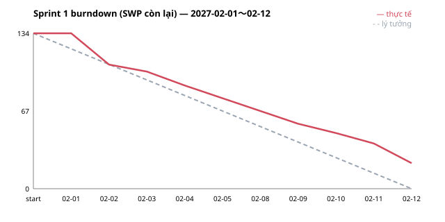

# Báo cáo tiến độ — Sprint 1

| Mục | Nội dung |
|---|---|
| Dự án | Sakura Market (hệ thống nghiệp vụ chợ thủy sản) — giai đoạn lập trình + UT |
| Iteration trên Project | **Sprint 1** |
| Kỳ báo cáo | 2027-02-01 〜 2027-02-12 (10 ngày làm việc) |
| Bảng theo dõi | [GitHub Project — Sakura Market LAB-5](https://github.com/users/khoanpm-3814/projects/1) (lọc Iteration = Sprint 1) |
| Người lập | PL |

> **Lưu ý:** đây là **báo cáo mẫu dựng từ giả lập** (bài thực hành LAB-5), chưa phải số liệu thực tế. Mỗi thành viên làm 6 giờ tập trung / ngày (TL 3 giờ / ngày). Các sự kiện lệch kế hoạch được đưa vào có chủ đích để minh họa cách báo cáo. Đội hình là vai trò giả định, không phải người thật.

Kính gửi Quý khách,

Chúng tôi xin báo cáo kết quả Sprint 1. Đội đã hoàn thành **26 / 31 issue (112 / 134 SWP, 84 %)**. Phần nền tảng chung (migration, guard API, audit, layout, CI) gần như đã xong. Còn **5 issue (22 SWP)** chuyển sang Sprint 2. Nguyên nhân chính là chờ duyệt môi trường Tokyo và 2 issue vượt giờ do chỗ hở trong spec. Chi tiết và đề nghị hỗ trợ ở mục 3.

---

## 1. Trạng thái

| Trạng thái | Số issue | Tổng SWP | Giờ ước | Ghi chú |
|---|---:|---:|---:|---|
| Done | 26 | 112 | 200 | Thực tế tiêu 210h: vượt 10h ở #7 và #26 (xem mục 2) |
| In Review | 0 | 0 | 0 | — |
| In Progress | 3 | 18 | 24 | #38 (E00-14) môi trường Tokyo · #268 (E10-08) danh mục mã audit · #274 (E10-11) kiểm phủ audit |
| Todo | 2 | 4 | 6 | #239 (E09-04a) helper mốc go-live · #288 (E11-09) /api/health |
| **Tổng cam kết** | **31** | **134** | **230** | Đã tiêu 219h; phần chưa xong còn khoảng 21h |

**Theo người phụ trách (vai trò giả định)**

| Phụ trách | Số issue | Giờ ước | Giờ đã tiêu | SWP Done | SWP chuyển Sprint 2 |
|---|---:|---:|---:|---:|---:|
| TL | 3 | 28 | 21 | 7 | 8 (#38) |
| BE-1 | 9 | 58 | 60 | 32 | 5 (#268, #288) |
| BE-2 | 9 | 60 | 60 | 38 | 0 |
| FE-1 | 2 | 16 | 16 | 7 | 0 |
| FE-2 (full-stack) | 7 | 60 | 60 | 28 | 3 (#239) |
| QA-1 | 1 | 8 | 2 | 0 | 6 (#274) |
| **Tổng** | **31** | **230** | **219** | **112** | **22** |

**Theo epic**

| Epic | Số issue | SWP cam kết | SWP Done | Còn lại |
|---|---:|---:|---:|---:|
| #1 E00 Nền tảng chung | 20 | 91 | 83 | 8 |
| #41 E01 Đăng nhập & phân quyền | 3 | 12 | 12 | 0 |
| #58 E02 Người tham gia & tư cách | 1 | 5 | 5 | 0 |
| #229 E09 Báo cáo & xuất CSV kế toán | 3 | 11 | 8 | 3 |
| #260 E10 Audit | 2 | 10 | 0 | 10 |
| #275 E11 Vận hành / offline / migration | 2 | 5 | 4 | 1 |

---

## 2. Burndown

| Ngày | SWP còn lại (thực tế) | SWP còn lại (lý tưởng) | Chênh |
|---|---:|---:|---:|
| Đầu sprint | 134 | 134.0 | 0 |
| 02-01 (T2) | 134 | 120.6 | +13.4 |
| 02-02 (T3) | 107 | 107.2 | −0.2 |
| 02-03 (T4) | 101 | 93.8 | +7.2 |
| 02-04 (T5) | 89 | 80.4 | +8.6 |
| 02-05 (T6) | 78 | 67.0 | +11.0 |
| 02-08 (T2) | 67 | 53.6 | +13.4 |
| 02-09 (T3) | 56 | 40.2 | +15.8 |
| 02-10 (T4) | 48 | 26.8 | +21.2 |
| 02-11 (T5) | 39 | 13.4 | +25.6 |
| 02-12 (T6) | 22 | 0.0 | +22.0 |

**Những điểm lệch so với kế hoạch**

- **Ngày 1 chưa có issue nào Done.** Issue đầu tiên của mỗi người là 8–12h, trong khi một ngày chỉ có 6h tập trung (TL 3h). Burndown chỉ giảm khi issue Done, nên đây là độ trễ của cách đo, không phải chậm thật. Ngày 2 đã về sát đường lý tưởng.
- **#7 (E00-02d) migration lô / giao dịch / せり vượt 6h** (12h → 18h): phải sửa thứ tự khóa bản ghi và một số cột theo quyết định thiết kế bổ sung sau bản thiết kế chi tiết.
- **#26 (E00-09) Idempotency-Key vượt 4h** (8h → 12h): bản thiết kế chưa có bảng lưu key, phải thiết kế thêm 1 bảng nhỏ.
- **Hai lần vượt giờ đẩy lùi việc phía sau:** BE-1 chưa xong #268 (E10-08), chưa bắt đầu #288 (E11-09); FE-2 chưa bắt đầu #239 (E09-04a).
- **#38 (E00-14) môi trường dev / staging / prod tại Tokyo dừng 3 ngày** chờ phía Quý khách duyệt tạo tổ chức Supabase Pro / Vercel (có thanh toán). Đã làm 5 / 12h.
- **#274 (E10-11) xếp quá sớm.** Issue này kiểm mọi hàm DB ghi đều có audit, nhưng phần lớn hàm nghiệp vụ chưa được viết. Khi lập kế hoạch, issue này chưa được khai báo phụ thuộc vào các hàm đó nên bị xếp vào Sprint 1, không thể xong trong sprint này. Sẽ dời sang Sprint 7 (xem R1).
- Từ ngày 3, đường thực tế luôn cao hơn đường lý tưởng; khoảng cách lớn nhất là 25.6 SWP vào 02-11.

---

## 3. Rủi ro trễ và hành động

| # | Rủi ro | Issue | Ảnh hưởng tới mốc nào | Hành động | Ai làm, khi nào |
|---|---|---|---|---|---|
| R1 | Chuyển 22 SWP (khoảng 21h) sang Sprint 2, trong khi Sprint 2 đã xếp 35 issue / 154 SWP / 270h (năng lực 330h, nhưng BE-1 / BE-2 gần kín) | #38, #268, #274, #239, #288 | Cuối Sprint 2 (2027-02-26): hoàn tất E00, nền cho mọi epic | Đưa phần chuyển sang lên đầu Sprint 2. Dời các issue ưu tiên thấp của BE-1 / FE-2 sang Sprint 3. Dời #274 tới sprint mà phần lớn hàm ghi đã có (đề xuất Sprint 7, cùng #273 test vector audit) | PL + TL, Sprint Planning 2027-02-15 |
| R2 | Chưa có duyệt tạo môi trường Tokyo (thanh toán Supabase Pro / Vercel) | #38 (E00-14), #37 (E00-13c CD) | Có môi trường staging (CD deploy staging ở Sprint 2); kéo theo demo cuối sprint | BrSE gửi lại yêu cầu duyệt kèm hạng mục chi phí. TL hoàn tất trong 2 ngày sau khi có tài khoản | BrSE gửi trước 2027-02-15 · **phía khách: phụ trách hạ tầng / mua sắm** duyệt trước 2027-02-17 · TL |
| R3 | BE là nút cổ chai: BE-1 / BE-2 gần kín 60h mỗi sprint từ Sprint 2 đến Sprint 6 (58–60h), FE-2 phải nhận thêm việc BE. Mỗi lần BE vượt giờ là màn FE phía sau bị đẩy theo | Toàn kế hoạch (Sprint 2〜9) | Hết lập trình dự kiến **~2027-06-04** (Sprint 9, chỉ còn #215), trễ khoảng 1 tuần so với WBS-4 LAB-1 (2027-02〜05). Ảnh hưởng ngày bắt đầu IT | Theo dõi velocity 2–3 sprint. Nếu dưới 85 % thì đề xuất thêm 1 BE từ Sprint 4, hoặc bắt đầu IT sớm cho các epic đã xong | PL, đánh giá cuối Sprint 3 (2027-03-12) |
| R4 | Lịch sprint chưa trừ ngày nghỉ lễ (giả lập tính đủ 10 ngày mỗi sprint): Tết Nguyên đán đầu tháng 2, nghỉ 30/4–1/5 phía Việt Nam, Golden Week phía Nhật | Sprint 1, Sprint 7 | Có thể đẩy mốc hết lập trình thêm vài ngày | Tính lại năng lực theo lịch nghỉ thực tế, báo lại Quý khách nếu mốc thay đổi | PL, trước Sprint Planning 2027-02-15 |
| R5 | QA-010 (mapping file nguồn migration, Phụ lục C) chưa có trả lời; hạn ban đầu 2026-12-15 | #321 (E11-33b), #322 (E11-33c) | Loader ở Sprint 5 / Sprint 6 → lượt chạy thử migration | Loader đang viết theo interface đọc có thể thay, chưa bị chặn ngay. Cần mapping trước Sprint 5 | BrSE nhắc mỗi tuần · **phía khách: phụ trách dữ liệu hệ thống cũ** trả lời trước 2027-03-19 |
| R6 | OQ-26 chưa chốt: tính P / hóa đơn theo tổng làm tròn từng lần giao hay theo tiền giao dịch lúc 確定 (lệch vài yên) | #125 (E05-01a), #173 (E07-04), E09 (CSV kế toán) | Tiền thưởng 完納奨励金, căn cứ hóa đơn và CSV kế toán (E07-04 bắt đầu ở Sprint 5) | Đang dùng giả định LAB-4. Đổi sau Sprint 5 sẽ phải làm lại test vector | BrSE · **phía khách: phụ trách kế toán** trả lời trước 2027-03-26 |
| R7 | OQ-04 chưa chốt: cách chạy bản sao DR và RPO 1 ngày | #300 (E11-16), #301 (E11-17) | DR / backup (Sprint 5, 8) và diễn tập backup / restore ở ST | 2 issue đang để `should`. Làm sau khi có trả lời | BrSE · **phía khách: phụ trách vận hành hệ thống** trả lời trước 2027-03-26 |
| R8 | 15 issue làm rõ spec đang chờ trả lời (vd chọn dịch vụ email #334, luật kỳ thưởng #331 / #332, xác nhận của ROLE-006 #329 / #330, BOM của CSV #335) | #325〜#339 | Sprint chứa issue liên quan. Trả lời muộn → phải làm lại | Đang làm theo giả định tạm (đã liệt kê trong tài liệu tiền đề gửi kèm) để không chặn. BrSE gom thành 1 lượt hỏi mỗi tuần, ưu tiên câu có issue trong 2 sprint tới. #334 cần trước Sprint 6 (#221 gửi email) | BrSE, hàng tuần · **phía khách: phụ trách nghiệp vụ / kế toán** |
| R9 | 完納奨励金 phức tạp: E07 có 39 issue lá / 149 SWP / 242h, trải từ Sprint 4 đến Sprint 9; test vector #213 / #214 ở Sprint 8, test tương tranh #215 ở Sprint 9 | E07 (#169), #213〜#215 | Hiểu sai quy tắc sẽ lộ muộn → làm lại sát mốc hết lập trình | Gửi bộ test vector (bảng đầu vào → kết quả mong đợi) để Quý khách xác nhận trên giấy từ Sprint 4, trước khi code. Demo 試算 → 確定 trên màn hình cuối Sprint 8 (2027-05-21), khi #190 (E07-07b) và #208 (E07-13b) xong | TL + QA-1 + BrSE, từ 2027-03-15 · **phía khách: phụ trách kế toán** xác nhận vector |

**Đề nghị Quý khách hỗ trợ:**
1. Duyệt tạo môi trường Tokyo (R2) trước **2027-02-17**.
2. Trả lời QA-010 trước **2027-03-19**; OQ-26 và OQ-04 trước **2027-03-26** (R5〜R7).
3. Xem các issue làm rõ #325〜#339 (R8). Chúng tôi sẽ gửi danh sách ưu tiên mỗi tuần.

---

## 4. Kế hoạch Sprint 2 (2027-02-15 〜 2027-02-26)

- Theo kế hoạch: **35 issue / 154 SWP / 270h**. Cộng phần chuyển từ Sprint 1 (22 SWP, khoảng 21h) → cần dời khoảng 15h sang Sprint 3 (không tính #274).
- Ưu tiên 1: xong phần chuyển sang #38, #268, #288, #239.
- Hoàn tất E00: #8 migration giao hàng / thanh toán, #17 ATT-02, #19 component tải tệp, #21 / #22 khung job, #27 hàm 業務日, #28 master data, #37 CD lên staging.
- Bắt đầu các epic nghiệp vụ: E03 Lô hàng (9 issue), E01 (7), E02 (4), E04 (3), E11 (3), E09 (1).
- Mục tiêu demo cuối sprint: staging tại Tokyo chạy được; đăng nhập qua AUTH-01 (#44); màn danh sách / chi tiết lô SCR-010 (#93), SCR-011 (#95) và quản lý tài khoản SCR-035 (#56).
- Theo dõi: velocity Sprint 1 là 84 %. Mục tiêu Sprint 2 ≥ 85 %; so giờ thực tế của #27 (issue mẫu SWP 10 / 8h).

---

## Lịch sử thay đổi

| Ngày | Nội dung | Người |
|---|---|---|
| 2026-11-11 | Bản đầu: báo cáo mẫu Sprint 1 (giả lập 2027-02-01〜02-12), burndown, rủi ro, kế hoạch Sprint 2 | PL |
